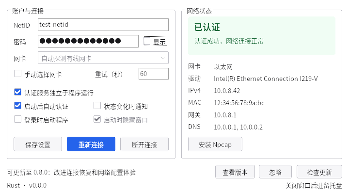
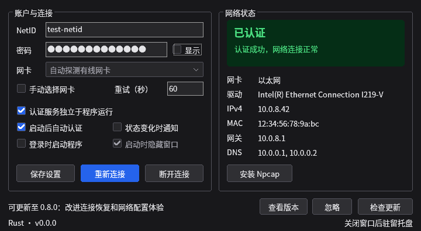

# SYSU NetAuth Rust 版

支持 Windows 10/11 x64（GUI、CLI、后台服务）、Linux x64（CLI、systemd）和 macOS 11+（CLI、launchd，实验性）。

## Windows 安装

使用 [Releases](https://github.com/peterrobot/sysu-netauth/releases) 中的 `Rust_msvc_x64` 或 `Rust_gnu_x64` Setup 安装程序。需要 [Npcap](https://npcap.com/#download)，程序提供安装引导。

在设置窗口填写 NetID 和密码，启用自动认证与服务独立运行。退出 GUI 后服务继续认证，并在睡眠、休眠恢复后重新连接。请先退出其他 802.1X 客户端。

配置与日志：`%ProgramData%\SYSUNetAuth\`。版本切换与故障排查见 [Windows 安装说明](../../docs/WINDOWS.md)。

窗口跟随 Windows 的应用浅色/深色设置，无需重启。以下为 Wine 下运行的 Rust GUI，使用示例数据。





## 构建

以下命令从仓库根目录执行，需要 Rust 工具链。

```sh
cargo build --locked --release
```

Windows 需要 Visual Studio C++ 工具和 Windows SDK；在开发者 PowerShell 中执行：

```powershell
./apps/rust/scripts/build.ps1 -SkipInstaller
./start.bat
```

安装 Inno Setup 6 后，省略 `-SkipInstaller` 可生成安装包。输出位于 `apps/rust/dist/`，包含 CLI、服务和 GUI 三个 EXE。

### Linux → Windows 交叉编译

```sh
sudo apt-get install clang llvm lld zip
rustup target add x86_64-pc-windows-msvc
cargo install --locked cargo-xwin --version 0.23.1
sh apps/rust/scripts/build-windows.sh
```

输出：`apps/rust/dist/sysu-netauth-windows-x64.zip`（MSVC，静态 CRT）。SDK 缓存默认位于 `target/xwin`，可用 `XWIN_CACHE_DIR` 修改；LLVM 工具带版本后缀时可设置 `NETAUTH_RC=/usr/bin/llvm-rc-19`。

解压到固定目录后，在 Windows 管理员终端注册服务：

```powershell
.\sysu_netauth_service.exe --install
sc.exe start SYSUNetAuth
.\sysu_netauth_gui.exe
```

GNU 目标使用 MinGW：

```sh
sudo apt-get install gcc-mingw-w64-x86-64 binutils-mingw-w64-x86-64 zip
rustup target add x86_64-pc-windows-gnu
sh apps/rust/scripts/build-windows-gnu.sh
```

GNU 输出：`apps/rust/dist/gnu/sysu_netauth/` 和 `apps/rust/dist/sysu-netauth-windows-gnu-x64.zip`。

### Linux 安装

```sh
sh apps/rust/scripts/build.sh
sudo sh apps/rust/scripts/install-linux.sh
sudo sysu_netauth config import /path/to/config.json
sudo sysu_netauth authenticate
```

配置文件：`/etc/sysu-netauth/config.json`。最小配置：

```json
{"username":"NetID","password":"密码","iface_mode":"auto","auto_auth":true}
```

配置包含凭据，应限制访问权限。程序负责 802.1X 认证，IP 地址与 DHCP 由系统网络管理器处理。

停止并禁用服务：`sudo systemctl disable --now sysu-netauth`。

### macOS 安装

提供 Apple Silicon（`macos_arm64`）与 Intel（`macos_x64`）程序包，需有线以太网，无需 Npcap。安装、配置与卸载见 [macOS 文档](docs/MACOS.md)。

在 macOS 上构建：`sh apps/rust/scripts/build-macos.sh`。输出位于 `apps/rust/dist/`。

## CLI

Windows 使用管理员终端；Linux 与 macOS 的服务操作使用 `sudo`。

```sh
sysu_netauth interfaces
sysu_netauth status --json
sysu_netauth watch --json
sysu_netauth authenticate
sysu_netauth logoff
sysu_netauth config
sysu_netauth config password
sysu_netauth config import /path/to/config.json
sysu_netauth check-update
```

直接操作网卡前需停止后台服务：

```sh
sysu_netauth probe --iface eth0
sysu_netauth authenticate --iface eth0 --username NetID --timeout 90
sysu_netauth logoff --iface eth0
```

直接认证完成后退出，持续续期需运行后台服务。省略密码参数时会交互式输入。

## 配置

| 字段 | 默认值 | 含义 |
| --- | --- | --- |
| `username`, `password` | 空 | NetID 和密码，需可编码为 GBK |
| `iface_mode` | `auto` | `auto` 自动选择，`manual` 固定网卡 |
| `iface` | 空 | 手动模式的网卡名或 Windows adapter ID |
| `auto_auth` | `true` | 自动认证及失败重试 |
| `retry_interval` | `60` | 重试间隔，15–3600 秒 |
| `service_mode` | `true` | Windows 服务独立运行 |
| `launch_gui_on_login` | `false` | Windows 登录时启动 GUI |
| `hide_window_on_login` | `true` | 登录启动时隐藏窗口 |
| `desktop_notify` | `true` | Windows 托盘通知 |

## 开发

```sh
cargo fmt --all --check
cargo clippy --locked --workspace --all-targets -- -D warnings
cargo test --locked --workspace
```

[架构与网络测试](docs/ARCHITECTURE.md) · [休眠恢复排查](docs/RESUME.md) · [性能记录](docs/PERFORMANCE.md) · [发行步骤](../../docs/RELEASING.md)
